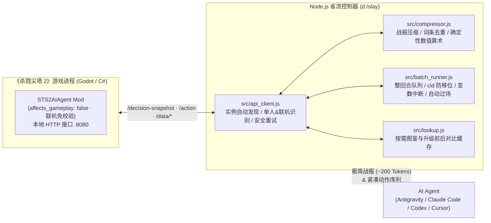

# 杀戮尖塔 2（Slay the Spire 2）极简省流 AI 交互控制器

一套**零截图、纯数据交互、极低 Token 消耗**的《杀戮尖塔 2》AI 游玩与联机辅助系统。  
无需让大模型一张张看游戏截图，也无需额外配置 MCP 或在游戏内填写 API Key——直接让具备终端执行能力的 AI Agent（如 Antigravity、Claude Code、Codex、Cursor 等）通过极简 CLI 读写实时内存状态、批量打出整回合连招，并与你单人托管、半自动共玩或与朋友 Steam 联机。

---

## ✨ 核心特性与省流黑科技

1. **0 截图纯内存交互（100% 文本精确读取）**
   - 基于社区开源通信 Mod [`CharTyr/STS2-Agent`](https://github.com/CharTyr/STS2-Agent)（Godot / C# .NET 9），直接读取手牌、能量、怪物意图、双方 Buff/Debuff、牌堆、遗物计数、地图拓扑与联机队友状态，告别昂贵且容易看错数字的视觉识图。
2. **四大极致省 Token 机制**
   - **高密度战报压缩 (`src/compressor.js`)**：将数千字节的原始 JSON 压成高信息密度单行战报，实测单步战斗快照可压缩至约 470~680 字节。
   - **按局增量词条去重 (`.cache/seen_cache.json`)**：同一局 (`run_id`) 内首次出现的卡牌、遗物、Buff 与术语附带规则说明；后续回合自动隐藏重复说明书，只保留名称、费用、层数与实时伤害预览，大幅削减上下文体积。
   - **确定性战斗算术预计算**：由本地 JS 代码直接算好 `[来袭总伤 | 护甲缺口 | 最大可叠甲 | 手牌直伤上限 | 斩杀线提示]`，省去大模型反复心算消耗的 Thinking Tokens，同时杜绝算错斩杀或护甲缺口。
   - **整回合批处理 + 无分支自动过场 (`src/batch_runner.js`)**：AI 可一次发送整回合序列（例如 `play 0 0; play 2; end`）；对无分支弹窗、战利品金币收取、单一道路移动、已完成事件翻页等自动推进（**0 Token 过场**）。
3. **手牌移位保护与变数智能中断**
   - 出牌队列在执行前会将手牌下标自动绑定到游戏内稳定的 `combat_card_id` (`cid`)，打出一张牌导致手牌左移也不会错打后续卡牌。
   - 一旦连招中途触发**抽牌/衍生牌 (`new_cards`)、选牌弹窗 (`pending_choice`)、敌人意图变化 (`intent_changed`)、掉血 (`took_damage`) 或目标死亡 (`target_gone`)**，立即安全中断队列并返回最新战报让 AI 重新规划。
4. **多人联机 100% 零冲突 (`affects_gameplay: false`)**
   - 根据游戏程序集 `ModManager.GetGameplayRelevantModNameList` 的机制，联机大厅只校验 `"affects_gameplay": true` 的模组。
   - 通信 Mod 清单中声明了 `"affects_gameplay": false`，属于纯客户端辅助工具：**你和朋友 Steam 联机时不会触发 Mod 版本/列表不一致报错，你的朋友也完全不需要安装任何东西！**

---

## 🏗️ 系统架构



---

## 📦 安装指南

### 环境要求
- **Node.js >= 20.0.0**（本系统采用零第三方 npm 依赖的原生 ESM 实现，无需执行 `npm install`）
- **《杀戮尖塔 2》**（已验证兼容 `v0.113.1` + `STS2AIAgent v0.19.2`）

### 第一步：安装游戏内通信 Mod（二选一，切勿重复安装）

#### 方式 A：Steam 创意工坊订阅（最推荐）
1. 打开 [`STS2 AI Agent` Steam 创意工坊页面](https://steamcommunity.com/sharedfiles/filedetails/?id=3796486050) 点击 **订阅**，等待下载完成。
2. 在 Steam 启动《杀戮尖塔 2》时选择 **带 Mod 启动（Play with Mods）**。
3. 如首次启动弹出代码加载确认，点击接受后重启一次游戏；在游戏主菜单 **Mods** 中确认已勾选启用 **STS2 AI Agent**。

#### 方式 B：手动部署 Release 文件
1. 从 [CharTyr/STS2-Agent Releases](https://github.com/CharTyr/STS2-Agent/releases) 下载 `sts2-ai-agent-v*-windows.zip` 并解压。
2. 在你的《杀戮尖塔 2》安装目录下新建 `mods\STS2AIAgent\` 文件夹，仅复制压缩包 `mod\` 目录内的以下三个文件进去：
   - `STS2AIAgent.dll`
   - `STS2AIAgent.pck`
   - `mod_id.json`（确认其中 `"affects_gameplay": false`）
3. 选择 **带 Mod 启动（Play with Mods）** 运行游戏并在 **Mods** 中启用它。

> ⚠️ **注意**：不要同时保留创意工坊订阅与手动 `mods\` 复制，否则会导致重复加载。本控制器直接对接 Mod 的本地 HTTP API，**无需在游戏内 `F8` 面板开启 MCP 或配置任何 API Key**。

---

### 第二步：获取本控制器并验证连通性

1. 克隆或下载本项目到本地目录（例如 `d:\slay`）：
   ```powershell
   cd d:\slay
   ```
2. 运行内置单元测试（验证压缩率、确定性算术、防移位与抽牌中断逻辑）：
   ```powershell
   npm test
   ```
   预期看到 `8` 项测试全部通过（`pass 8 / fail 0`）。
3. 启动《杀戮尖塔 2》（带 Mod 启动）进入主菜单后，运行健康检查：
   ```powershell
   node sts2.js health
   ```
   看到 `[连接正常] 服务=sts2-ai-agent ... 状态=ready` 即代表全部部署成功！

---

## 🎮 三大游玩模式

| 模式参数 | 适用场景 | 行为边界说明 |
| :--- | :--- | :--- |
| `--mode auto` | **全自动闯关** | AI 下发连招后，自动跳过无分支弹窗、战利品金币拾取、已完成事件翻页、唯一地图路径等过场，直到下一个需要决策的节点才唤醒 AI。 |
| `--mode assist` | **半自动军师 / 托管** | 只读 `observe` 可完全不抢鼠标做战术顾问；若使用 `act` 托管战斗，一旦进入**选牌奖励、商店、火堆、事件选项、宝箱、牌库选牌、地图分叉**，脚本强制停止自动推进并标记 `[需要玩家确认]`。 |
| `--mode coop` | **多人联机兼容** | 自动读取并展示联机队友的角色、血量、护甲、能量与地图投票；若本机已投票、已就绪或已结束回合，自动输出 `[等待队友]` 状态提示，不重复触发越界或错误操作。 |

---

## 🛠️ CLI 命令与动作 DSL 速查手册

### 核心命令

```bash
# 1. 检查游戏与 Mod 连通状态
node sts2.js health [--instance human|companion|<pid>] [--url <http://127.0.0.1:8080>]

# 2. 只读观察当前精简战报（军师模式常用，不执行任何点击）
node sts2.js observe [--mode assist|auto|coop] [--full]

# 3. 执行单步或整回合连招队列，返回下一决策点战报
node sts2.js act "<动作序列>" [--mode auto|assist|coop] [--reason "<简短理由>"] [--full]

# 4. 按需查询图鉴（支持卡牌升级前后对比、遗物、怪物、药水、事件、状态）
node sts2.js lookup "<关键词>" [--type all|cards|relics|monsters|potions|events|powers|characters] [--refresh]

# 5. 清理本地词条去重缓存与图鉴缓存
node sts2.js cache clear
```

> 💡 参数说明：
> - `--full`：临时跳过按局词条去重，完整显示当前界面所有卡牌/遗物/Buff 的规则描述。
> - `--instance companion`：当使用 Mod 内置的本地双开“邀请 AI 队友”功能时，可直接接管操作副窗口队友角色。

---

### `act` 紧凑动作序列（DSL）速查表

多步动作之间用英文分号 `;` 或换行分隔：

| 场景 | 简洁写法（推荐） | 等价完整动作 | 说明 |
| :--- | :--- | :--- | :--- |
| **出牌** | `play 0 1` 或 `p 0 1` | `play_card` | 打出下标 `0` 的手牌，目标为 `1` 号敌人（无目标牌可省略目标，如 `play 2`） |
| **按稳定 ID 出牌** | `play cid:12 0` | `play_card` | 直接按手牌括号里的 `cid` 指认，彻底无视手牌位置变化 |
| **结束回合** | `end` | `end_turn` | 结束当前玩家战斗回合 |
| **药水** | `potion 0 0` / `discard_potion 0` | `use_potion` / `discard_potion` | 使用或丢弃第 `0` 格药水（需要目标时填第二个数字） |
| **选地图路线** | `map 1` | `choose_map_node` | 前往/投票选择 `[1]` 号地图节点 |
| **奖励结算** | `pick_card 0; collect` | `choose_reward_card` / `collect_rewards_and_proceed` | 选 `[0]` 号奖励卡并自动领取其余非卡牌奖励；跳过拿牌用 `skip_card`；单领某项用 `reward 0` |
| **事件 / 火堆** | `event 0` / `rest 1` | `choose_event_option` / `choose_rest_option` | 选择事件选项或火堆操作（联机目标火堆可写 `rest 0 1`） |
| **宝箱房** | `chest` / `treasure 0` | `open_chest` / `choose_treasure_relic` | 打开宝箱 / 选择第 `0` 个宝箱遗物 |
| **商店** | `shop open; buy_card 0; remove_card` | `open_shop_inventory` / `buy_*` / `remove_card_at_shop` | 也支持 `buy_relic 0`、`buy_potion 0`、`buy_blitz 0`、`shop close` |
| **选牌网格** | `select 2; confirm` | `select_deck_card` / `confirm_selection` | 删牌、升级、变化、附魔或手牌多选界面 |
| **开局 / 菜单** | `char 3; embark` | `select_character` / `embark` | 选人出发；也支持 `new_run standard`、`continue`、`proceed`、`modal confirm` |
| **原始兜底** | `raw {"action":"proceed"}` | 任意原生动作 | 直接透传完整 JSON 到 Mod 的 `POST /action` |

---

## 📊 战报输出示例

同一场战斗第 2 回合的实际压缩输出（已自动隐藏第 1 回合见过的卡牌/Buff 长文本，仅展示变化数值与新卡）：

```text
[界面:COMBAT | 模式:单人 | T2 | 层:2 | 0 | Boss:SOUL_FYSH_BOSS | 亡灵契约师 | 控制:auto]
[执行结果] 已执行 4/4 步 | 停止原因:completed
我方: HP 63/66 | 护甲 0 | 能量 3 | 宠物: 奥斯提 1/1 格挡0
[战局算术] 来袭总伤:8 | 护甲缺口:8 | 最大可叠甲:10 | 手牌直伤上限:13
敌人:
- [0] 噬尸蛞蝓 HP 27/27 | 意图:Attack 8 | Buff:RAVENOUS_POWER 4
- [1] 噬尸蛞蝓 HP 20/26 | 意图:Debuff | Buff:RAVENOUS_POWER 4
手牌:
- [0 cid:5] 防御 [1费]
- [1 cid:6] 防御 [1费]
- [2 cid:7] 打击 [1费] (目标:0,1) -> [0]:6伤 [1]:6伤
- [3 cid:8] 亡灵精通 [2费] | 召唤5。 每当奥斯提失去生命值时， 所有敌人失去等量生命值。
- [4 cid:9] 出击 [1费] (目标:0,1) -> [0]:7x?伤 [1]:7x?伤 | 奥斯提造成7点伤害。 这张牌额外造成等量于奥斯提当前生命值的伤害。
牌堆: 抽:打击 [1费] | 弃:打击*2 [1费], 护卫 [1费], 防御*2 [1费]
可用动作: end_turn, play_card, save_and_quit
```

AI 读完后只需输出一句简洁调用即可打完整回合：
```bash
node sts2.js act "play 3; play 4 1; end" --mode auto --reason "亡灵精通强化奥斯提并反伤，出击重创1号目标"
```

---

## 🤖 给其他 AI Agent 使用的 Prompt / 技能模板

如果你想把这个工具接入 Claude Code、Codex、Cursor 或其他支持终端命令的 Agent，只需把下面这段指令放进项目的 `CLAUDE.md` / `AGENTS.md` 或系统提示词中：

```markdown
你可以通过运行 `d:\slay\sts2.js` 来直接阅读《杀戮尖塔 2》的实时数据并控制游戏。
严禁截图游玩，严格遵守以下交互流程以节省 Token：
1. 开局前先运行 `node d:\slay\sts2.js health` 确认游戏已连通。
2. 查看局面用 `node d:\slay\sts2.js observe --mode auto`（纯顾问模式用 `--mode assist`）。
3. 尽量在一次 `act` 调用中规划整个回合或连续确定动作，例如：
   `node d:\slay\sts2.js act "play 0 0; play 2; end" --mode auto --reason "简短理由"`
   - `act` 的返回值本身就是下一决策点的压缩战报，不要在每次 `act` 后重复调用 `observe`。
   - 如果某张牌触发了抽牌、弹窗或敌人意图变化，脚本会自动中断队列并立刻返回最新局面。
   - 若不确定某张牌/遗物/事件的效果或升级前后数值，运行 `node d:\slay\sts2.js lookup "<关键词>"`。
4. 在 `--mode assist` 下看到 `[需要玩家确认]` 时，停止出手，先向玩家分析局势并给出推荐选项。
```

---

## ❓ 常见问题排查

- **`[未连接游戏] 无法连接到杀戮尖塔2本地接口`**
  - 请确认是从 Steam 选择 **带 Mod 启动（Play with Mods）** 启动的游戏，并在主菜单 **Mods** 页面勾选启用了 `STS2 AI Agent`。
  - 如果你的客户端运行在隔离沙箱终端中，请确保终端允许访问本机回环地址 `127.0.0.1:8080`（或 Mod 动态分配的端口）。
- **和朋友 Steam 联机时会提示 Mod 不一致吗？**
  - 不会。本方案依赖的 `STS2AIAgent` 在清单中标记了 `"affects_gameplay": false`，游戏联机握手不会将它纳入一致性校验列表，朋友无需安装。
- **游戏途中不小心手动把某张牌效果忘了？**
  - 运行 `node sts2.js observe --full` 可强制完整输出当前页面全部描述文本，或用 `node sts2.js lookup "<牌名>"` 随时查词条与升级预览。
- **游戏版本更新后能用吗？**
  - 启动时 `node sts2.js health` 会自动回报 `兼容自检缺失` 数量（源于 Mod 对游戏内部反射成员的自检）。若游戏大更新导致字段缺失，只需升级 `STS2AIAgent` Mod 版本即可，控制器侧接口保持向后兼容。

---

## 🙏 致谢

- 游戏内通信与状态桥接 Mod：[`CharTyr/STS2-Agent`](https://github.com/CharTyr/STS2-Agent)
- 灵感参考（一代 DeepSeek 游玩项目）：`xiaoyu-spire-agent` / `spire-agent`
